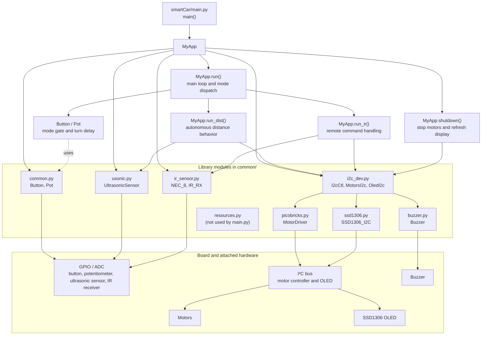

# Smart car v6 architecture

`main.py` is the application entrypoint. Its `main()` constructs `MyApp` in
distance mode, runs the application loop, and shuts the car down before
resetting the board.

The libraries also rely on MicroPython platform modules such as `machine` and
`utime`, which are provided by the board runtime rather than this repository.
