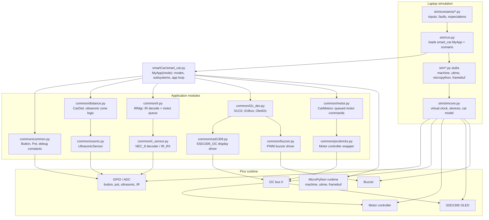
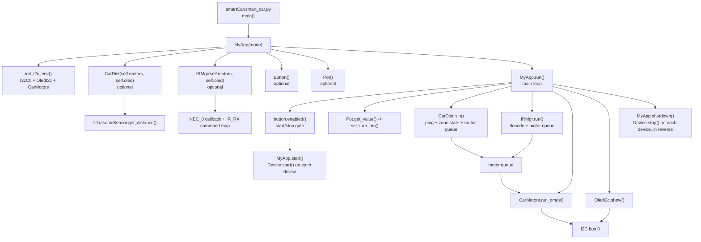

# Smart car architecture

`smartCar/smart_car.py` is the application entry point. `main()` creates a
`MyApp` with a `MODE_*` bitmask, installs the I2C environment, wires in optional
distance and IR managers, and then runs the main loop until a reset is triggered.

The app loop is mode-driven: button and potentiometer inputs are optional, and the
car may run in distance-only, IR-only, or combined modes. The actual hardware
interaction is mediated by I2C wrappers in `common/i2c_dev.py`, while the
MicroPython runtime (`machine`, `utime`, etc.) remains external to this repo.

`I2cCtl`, `OledI2c`, `CarMotors`, `CarDist`, `IRMgr` and `IR_RX` derive from
`common.Device`. Each constructor ends with `init()`, leaving the device off;
`MyApp.start()` turns them on when the button enables the car and
`MyApp.shutdown()` turns them off. A new device overrides the `_init()`,
`_start()` and `_stop()` hooks and adds itself to `MyApp.devices`.
