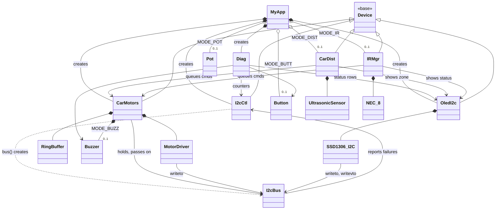
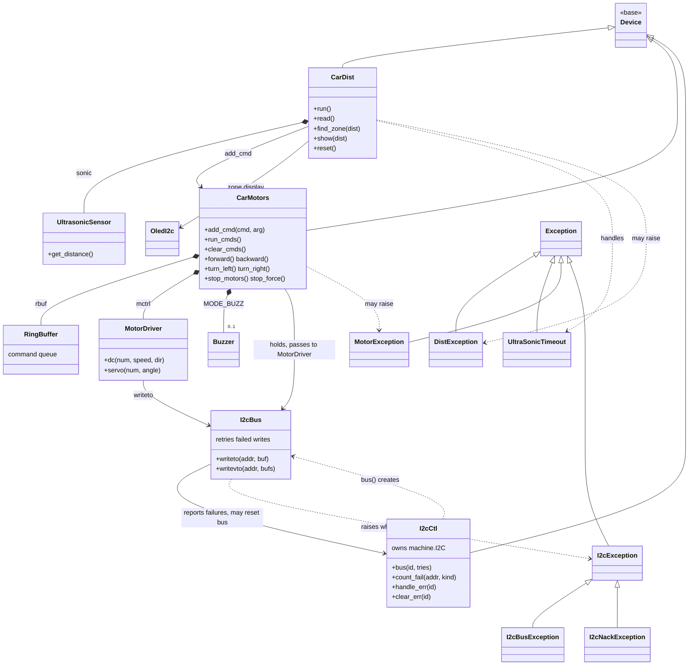
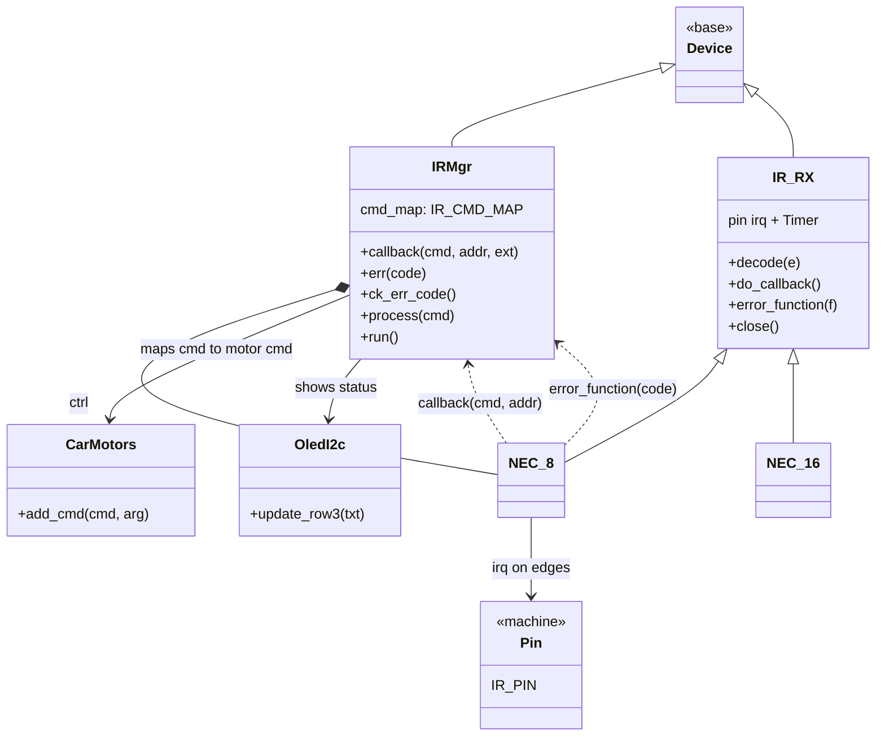
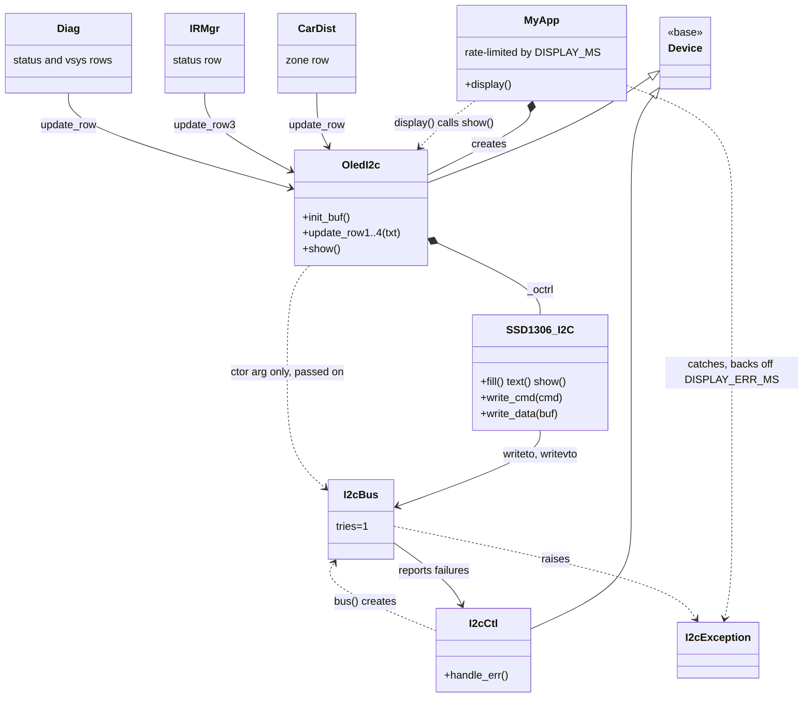
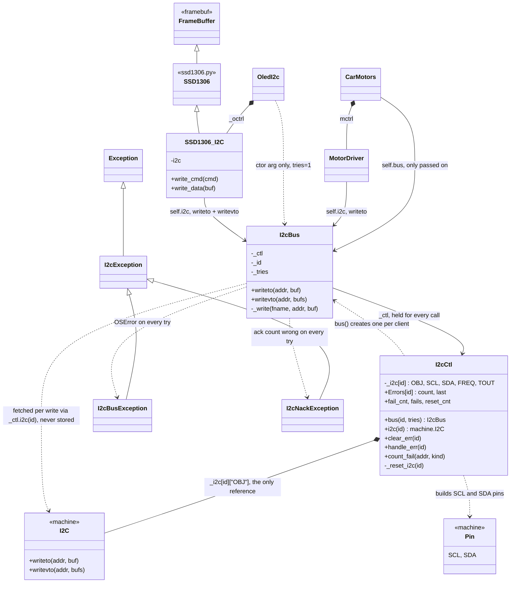

# Smart Car Class Diagrams

Five views: an overall top-down diagram, then one each for the motor control path, the IR path, the OLED path and the I²C classes.

## 1. Overall

`MyApp` is at the top, the devices it starts and stops are in the middle, and the hardware wrappers and helpers are at the bottom.

The `MyApp.devices` list (started in order, stopped in reverse) holds the I²C controller, OLED, motors and any enabled distance/IR device. `Button`, `Pot` and `Diag` are not in it. `SSD1306_I2C` is the display driver from `ssd1306.py`. `OledI2c` is only handed the bus at construction and passes it straight to `SSD1306_I2C`; it never writes to it itself. Exception classes are shown in the focused diagrams.

## 2. Motor control path (distance, I²C, motors)

Flow: `CarDist.run()` reads the sonic sensor, maps the distance to a zone and queues a command with `CarMotors.add_cmd()`. `CarMotors.run_cmds()` drains the queue through `MotorDriver`, which calls `I2cBus.writeto()`. `CarMotors` itself only holds the bus and hands it to `MotorDriver`. A failed write is retried, reported to `I2cCtl`, and `I2cException` is raised if all tries fail.

## 3. IR path

Flow: the pin interrupt feeds `NEC_8`, which decodes frames and calls `IRMgr.callback()` (errors go to `IRMgr.err()`). `IRMgr.run()` processes the saved command through `cmd_map`, queues a motor command and updates the OLED. `NEC_8` is created once; its pin irq is only on while `IRMgr` is started. `NEC_16` is available but unused.

## 4. OLED path

Flow: `CarDist`, `IRMgr` and `Diag` only update text rows in the `OledI2c` buffer. `MyApp.display()` calls `show()` at most every `DISPLAY_MS`, which pushes the buffer through `SSD1306_I2C` and `I2cBus`. The OLED bus uses `tries=1` so a failing display cannot block the loop. On `I2cException` the app waits `DISPLAY_ERR_MS`, and the buffer stays marked updated so the next `show()` redraws it.

## 5. I²C classes and how `machine.I2C` is reached

`I2cCtl` is the sole owner of the `machine.I2C` object, held in `_i2c[id]["OBJ"]`. Nothing else holds it. `MyApp` asks `I2cCtl.bus()` for an `I2cBus`: one with default tries goes to `CarMotors`, which keeps it and passes it to `MotorDriver`; one with `tries=1` goes to `OledI2c`, which does not keep it and passes it to `SSD1306_I2C`. The classes that write (`MotorDriver` via `writeto`; `SSD1306_I2C` via `writeto` for commands and `writevto` for pixel data) call the bus, and on every write `I2cBus._write()` calls `_ctl.i2c(id)` to fetch the current `machine.I2C` and invokes `writeto` or `writevto` on it.

Because the lookup happens per write, `I2cCtl._reset_i2c()` can recover a stuck bus by clocking out SDA, then replacing `_i2c[id]["OBJ"]` with a new `I2C`. The motors, OLED and any other bus holders pick up the new object without rebinding.

On each `OSError`, `I2cBus` calls `I2cCtl.handle_err()`, and a run of errors triggers the reset. A good write calls `clear_err()`. After the last try fails, `I2cBus` calls `count_fail()` and raises `I2cBusException` (OSError) or `I2cNackException` (wrong ack count).
