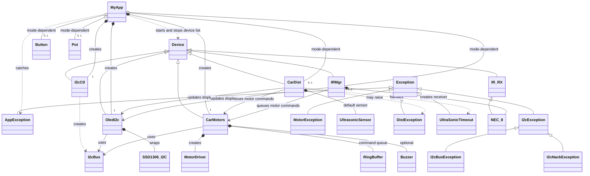

# Smart Car Class Diagram

The diagram centers on `MyApp` and shows its application collaborators, class inheritance, and key object relationships.

`CarDist` and `IRMgr` are created only when their modes are enabled. `Button` and `Pot` are also mode-dependent; the buzzer is optional. The `MyApp.devices` lifecycle list contains the I²C controller, OLED, motors, and any enabled distance/IR devices. The button and potentiometer are not in that list.

`SSD1306_I2C` is an external display-driver class wrapped by `OledI2c`.
